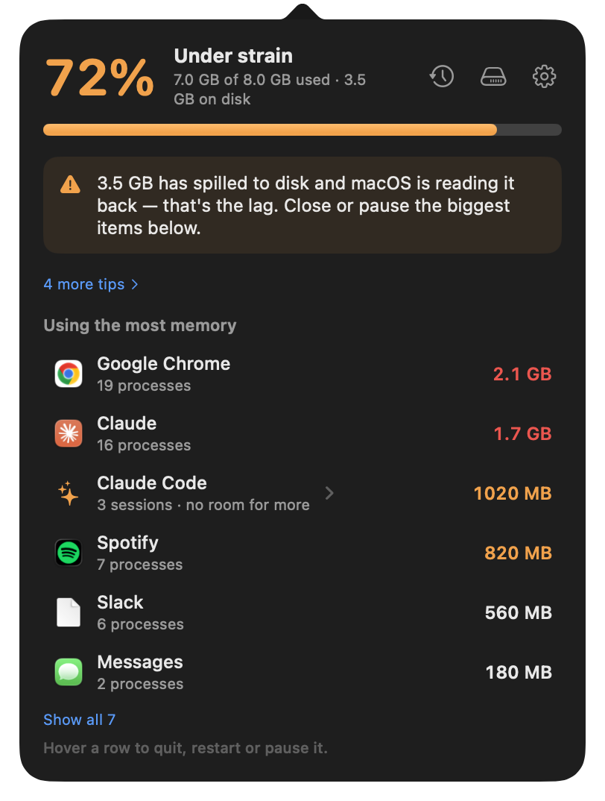
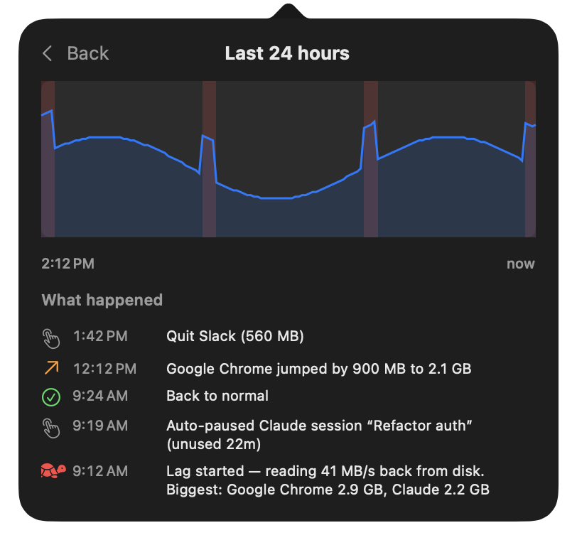
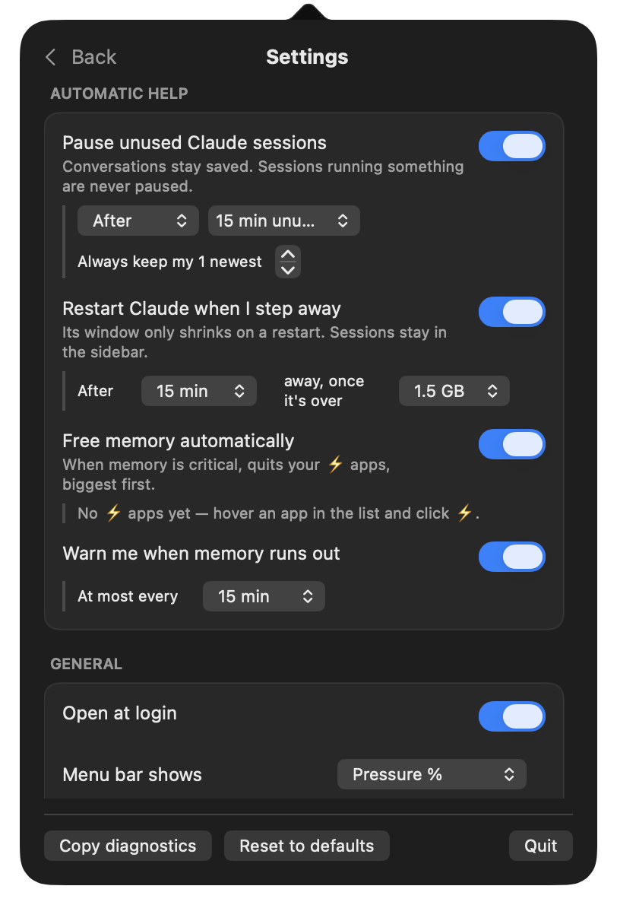

<div align="center">

# Mac Memory Monitor

**A tiny menu bar app that shows why your Mac is lagging — and fixes it in a click.**

<a href="https://github.com/ryan-helou/MacMemoryMonitor/releases/latest"></a>

  

<br><br>




</div>

## Why

When your Mac runs out of memory, it starts using the disk instead — and everything slows down. That's the lag you feel with lots of Chrome tabs, chat apps and AI coding sessions open.

Mac Memory Monitor shows how close you are to that point, what's using the memory, and lets you free it in one click. Built for 8 GB Macs, useful on any Mac.

## Install (1 minute)

1. **[Download the latest version](https://github.com/ryan-helou/MacMemoryMonitor/releases/latest)** and unzip it.
2. Drag **Mac Memory Monitor** into your **Applications** folder and open it.
3. macOS will warn that it can't verify the app (it isn't notarized by Apple yet). Click **Done**, then go to **System Settings → Privacy & Security** and click **Open Anyway**. Only needed once.
4. Look for **● 64%** in your menu bar. Not there? **System Settings → Menu Bar** → turn on **Mac Memory Monitor**.

Works on Apple Silicon and Intel, macOS 14 or newer.

<details>
<summary><b>Install with Homebrew</b></summary>

```bash
brew trust ryan-helou/tap
brew install --cask ryan-helou/tap/mac-memory-monitor
```
</details>

<details>
<summary><b>Build it yourself</b></summary>

You need Apple's free developer tools (your Mac offers to install them if missing).

```bash
git clone https://github.com/ryan-helou/MacMemoryMonitor.git
cd MacMemoryMonitor
./build.sh
```
</details>

## What it does

**See what's slowing you down**
- Memory pressure in the menu bar — green, orange or red
- The apps using the most memory, with all their hidden helper processes counted
- A 24-hour history: when your Mac lagged and which app caused it

**Fix it in one click**
- Quit or relaunch any app (relaunching gives back memory an app has slowly built up)
- Tips for what to do right now, like turning on Chrome's Memory Saver
- Find big files in Downloads, Movies and developer caches and move them to the Trash

**Let it handle things for you** (all optional)
- Warns you when memory is running out — with buttons to fix it in the notification
- Spots apps whose memory keeps climbing and offers a restart
- Quits apps you've marked ⚡ when your Mac is about to freeze

**Made for Claude Code users**
- Every session grouped with its helper processes, shown by title and when you last used it
- Pauses sessions you haven't used in a while — the conversation stays saved, and it never pauses one that's still working
- Restarts the Claude app while you're away (its window grows to 2+ GB over a few days)

Press **⌥⌘M** anywhere to open the panel.

<p align="center"></p>

## Settings

Everything automatic can be switched off or tuned in **Settings** (gear icon): how long before sessions pause, when to warn you, what the menu bar shows, how sensitive it is, which tips you see, and more. **Reset to defaults** undoes it all.

Developers can change every threshold in one file: [`Sources/MacMonitor/Config.swift`](Sources/MacMonitor/Config.swift).

## FAQ

**Is it safe?** It never quits or stops anything unless you click, or you've switched on an automatic feature. Anything that could lose work asks you to click twice.

**Does it slow my Mac down?** No — it uses about 50 MB and under 1% CPU, and checks less often when you're not looking at it.

**Will pausing a Claude session lose my conversation?** No. It's saved; reopen it from the Claude sidebar.

**Why the "can't verify" warning?** Getting rid of it costs $99/year for an Apple developer account. The app is open source, so you can read every line or build it yourself. [Help with this →](https://github.com/ryan-helou/MacMemoryMonitor/issues/7)

**Does it collect data?** No. It works offline and keeps everything on your Mac. The only time it goes online is the update check, which you can set to Never.

## Help make it better

Bug reports, ideas and code are all welcome.

- **Found a bug?** Settings → **Copy diagnostics**, then [open an issue](https://github.com/ryan-helou/MacMemoryMonitor/issues/new/choose) and paste it (no personal names are included).
- **Want to help?** Start with a [good first issue](https://github.com/ryan-helou/MacMemoryMonitor/labels/good%20first%20issue) and read [CONTRIBUTING.md](CONTRIBUTING.md).
- **Questions or tips?** Head to [Discussions](https://github.com/ryan-helou/MacMemoryMonitor/discussions).

## Uninstall

Open **Settings → Quit**, then drag **Mac Memory Monitor** from Applications to the Trash.

## License

MIT — free to use, change and share. See [CHANGELOG.md](CHANGELOG.md) for what's new.
